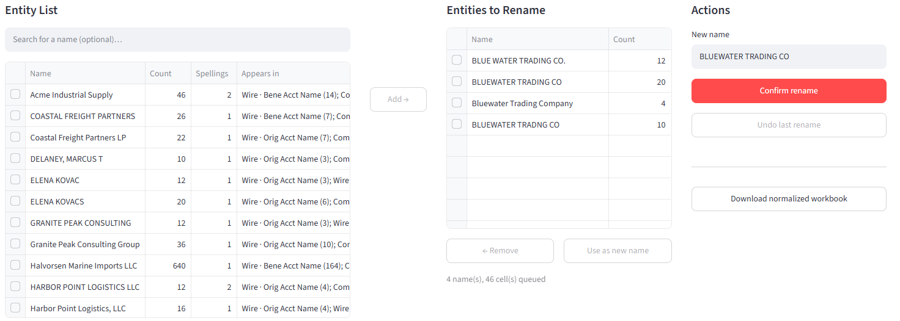
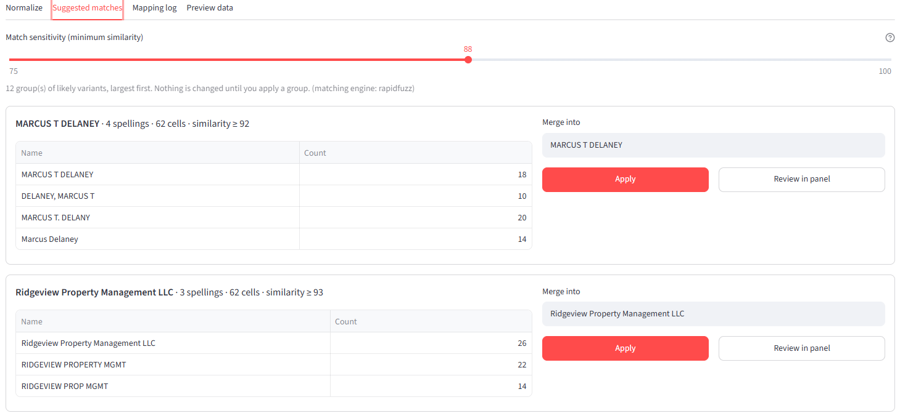
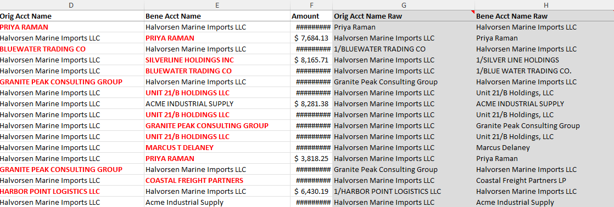

# Entity Normalizer

A tool for standardizing counterparty names in wire-transfer data, built for
financial crime investigations.

The same counterparty usually appears in wire data under many spellings:

```
1/HARBOR POINT LOGISTICS LLC
Harbor Point Logistics, LLC
HARBOR PT LOGISTICS
HARBOUR POINT LOGISTICS LLC
```

Until those are merged, pivot tables and counterparty totals undercount real
relationships, and flows to a single entity look like many unrelated
payments. Entity Normalizer finds and merges the variants with a full audit
trail, and the original data is never altered.

> All data in this repository is synthetic. Every name is fictional.



**Suggested matches** groups likely variants of the same entity for one-click approval:



**Excel export:** normalized names in bold red, with the original values preserved in grey raw columns:



## Features

- **Three-panel workflow.** Search the entity list, queue names to rename,
  confirm. The new-name box prefills with the most common spelling.
- **Case- and spacing-insensitive matching.** "Acme Corp", "ACME CORP" and
  "acme  corp" are one entity, both in the list and when renaming.
- **Suggested matches.** Likely variants are grouped automatically: legal
  suffixes are ignored (INC, LLC, N.A.), abbreviations are expanded
  (BK → BANK, INTL → INTERNATIONAL), and word-order flips ("DELANEY, MARCUS T")
  and typos are caught. Each group is approved with one click or reviewed
  first. Nothing changes without the investigator's say-so.
- **Unlimited undo.** Every rename is a step in a log, not a cell overwrite.
- **Audit trail.**
  - Raw snapshot columns are kept at the end of each sheet.
  - Changed cells are marked in bold red in the export.
  - A **Mapping Log** sheet records every step with a timestamp and cell count.
- **Reusable alias tables.** Export `original → normalized` pairs and apply
  them to the next case. Reopening an exported workbook restores the session
  automatically.
- **SWIFT cleanup.** Strips the structured-field `1/` name-line prefix, but
  only at the start of the value, so a name like `UNIT 21/B HOLDINGS` is left
  intact.

### Why strip `1/`?

In SWIFT MT103 payment messages, the ordering customer (field **50F**) and
the beneficiary (field **59F**) can be sent in a structured format where each
line starts with a code: `1/` for the name, `2/` for an address line, and
`3/` for the country and town. When those fields reach a wire extract, the
name often keeps its `1/` marker.

So the same counterparty appears two ways, depending on whether the sending
bank used the structured or free-text format:

```
1/HARBOR POINT LOGISTICS LLC
HARBOR POINT LOGISTICS LLC
```

To a spreadsheet or database, these are different values. A pivot on
counterparty splits one entity into two rows and understates its totals.
Removing the line marker is the first step before any name matching. The
marker is removed only at the start of the value, since it is never part of
the name itself.

## Quick start

```bash
pip install -r requirements.txt
python data/generate_sample.py   # optional: regenerate the synthetic case
streamlit run app.py
```

Click **Load sample** in the sidebar, or upload your own workbook.

### Expected workbook layout

| Sheet      | Name columns                       | Notes                                     |
|------------|------------------------------------|-------------------------------------------|
| `Wire`     | `Orig Acct Name`, `Bene Acct Name` | all rows                                  |
| `Combined` | `Description`, `Account Name`      | rows where `Tab Name` = `Wire` by default |

Other sheets pass through unchanged, and any `Amount` column gets accounting
format. Sheet and column names are set in `DEFAULT_CONFIG` in
`normalizer/core.py`.

## Design

```
raw snapshot ──► SWIFT prefix cleanup ──► replay rename steps ──► current values
 (read-only)                               (ordered, undoable)
```

Current values are always *derived*, never edited in place. This one
decision provides undo, the audit log, alias export, and session restore,
all for free. Renames are resolved once per distinct name rather than once
per cell, so it stays fast on large cases.

Suggestions run in two passes:

1. **Exact match on a simplified key.** Uppercased, punctuation removed,
   abbreviations expanded, legal suffixes dropped.
2. **Fuzzy match.** Compares the best of a word-order-insensitive score and a
   spacing-insensitive score. To avoid comparing every pair, only names
   sharing a word prefix are compared.

The suggested canonical spelling for each group is the most *central* name,
meaning the one most similar to the rest. That keeps a frequent typo from
being proposed as the canonical spelling.

Uses [rapidfuzz](https://github.com/rapidfuzz/RapidFuzz) when installed, and
falls back to Python's built-in `difflib` otherwise.

## Background

This is a Python rebuild of an Excel/VBA tool I wrote for investigation
casework. The rebuild fixed several issues in the original:

| Original behavior | Rebuild |
|---|---|
| Name list merged case variants, but rename matched exact case only, so variants survived | One match key used everywhere |
| `Replace(x, "1/", "")` removed `1/` anywhere in a name | Prefix removed only at the start |
| Name list drew from wire rows only, but rename touched every row on `Combined` | Rename scope matches the list, with an opt-in toggle |
| Single-level undo | Unlimited undo through the rename log |
| No record of changes once the form closed | Mapping log, alias table, session restore |
| Last row determined from the first column only | Whole columns processed |

## Project layout

```
app.py                     Streamlit dashboard
normalizer/core.py         Session, cleaning, rename/undo, alias tables
normalizer/suggest.py      Fuzzy duplicate detection
normalizer/export.py       Formatted Excel export
data/generate_sample.py    Synthetic case generator
data/sample_case.xlsx      Generated sample
tests/                     Unit tests (pytest or unittest)
```

## Tests

```bash
python -m pytest            # or: python -m unittest discover tests
```

## Possible next steps

- Configurable sheet/column mapping in the UI
- Load a firm-wide alias list alongside the per-case table
- Entity-resolution scoring across account numbers and addresses, not just names
